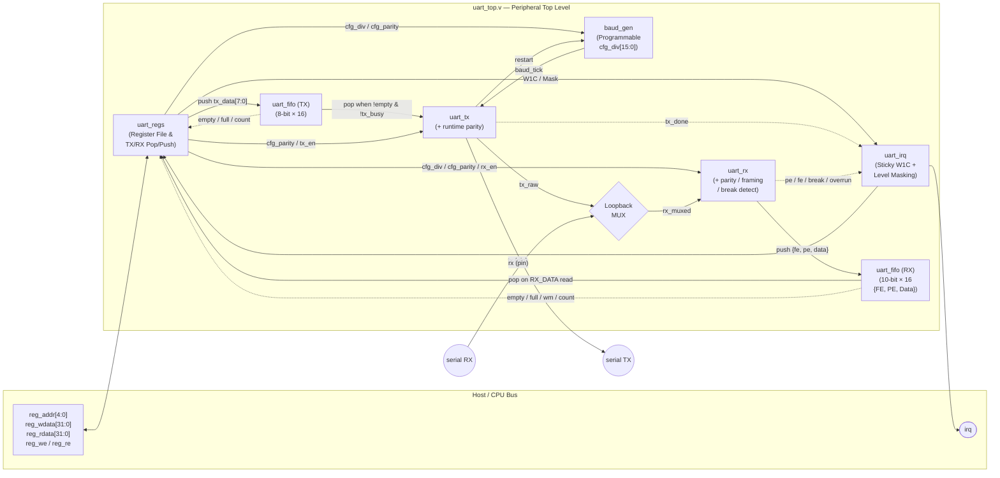
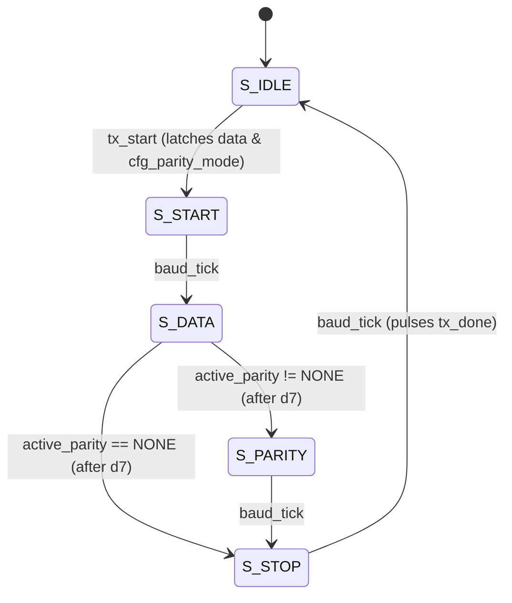
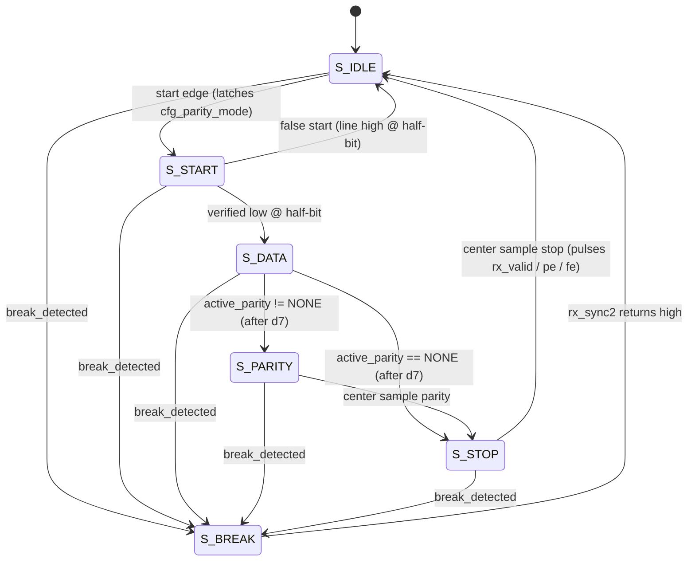
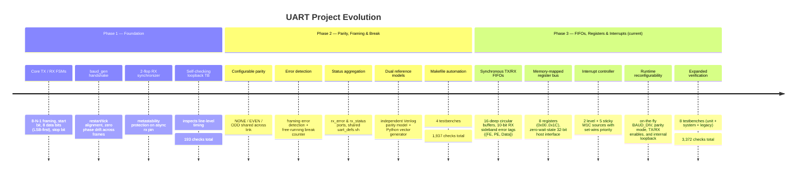

# 8-bit UART Communication System in Verilog HDL


A complete, CPU-attachable, synthesizable 8-bit UART peripheral written in plain Verilog-2001 featuring synchronous TX/RX FIFOs with sideband error tags, runtime-programmable baud and parity configuration, a level- & sticky-sensitive interrupt controller, and a clean 8-register memory-mapped host bus interface, verified across a regression suite.


---

## Table of contents

- [Overview](#overview)
- [Features](#features)
- [Architecture](#architecture)
- [Register map & programming model](#register-map--programming-model)
- [Frame format](#frame-format)
- [TX / RX finite state machines](#tx--rx-finite-state-machines)
- [Repository layout](#repository-layout)
- [Getting started](#getting-started)
- [Design philosophy](#design-philosophy)
- [Project history: Phase 1, Phase 2, Phase 3](#project-history-phase-1,-phase-2,-phase-3)
- [Documentation](#documentation)

---

## Overview

This repository implements a complete, CPU-ready UART (Universal Asynchronous Receiver/Transmitter) peripheral entirely in synthesizable Verilog-2001: a runtime-programmable baud-rate generator, transmitter and receiver FSMs, parameterized synchronous TX and RX FIFOs, a sticky/level interrupt controller, and a memory-mapped register block wired together inside `uart_top`.


It has evolved across three documented phases:

1. **Phase 1: Foundation** — Core TX/RX/loopback engines with clean-frame timing only.
2. **Phase 2: Parity, framing, and break detection** — Configurable parity (`NONE` / `EVEN` / `ODD`), framing-error detection, and free-running break-condition detection, verified against two independent reference models.
3. **Phase 3: FIFOs, Register Interface & Interrupts** *(current)* — Transforms the standalone serial engine into a complete memory-mapped CPU peripheral with 16-entry synchronous TX/RX FIFOs, per-byte sideband error tagging, runtime baud/parity/loopback reconfiguration, and a W1C (Write-1-to-Clear) interrupt controller.

Every design decision — not just what was built, but *why*, and what alternatives were rejected — is documented in [`docs/architecture.md`](docs/architecture.md) and [`CHANGELOG.md`](CHANGELOG.md). Every test and claim of correctness is tracked in [`docs/verification.md`](docs/verification.md).

---

## Features

- **8 data bits, LSB-first**, 1 start bit, 1 stop bit — classic UART framing.
- **Runtime-configurable parity & baud rate** — `NONE`, `EVEN`, or `ODD` parity and custom 16-bit clock divisors (`BAUD_DIV >= 2`) can be programmed on the fly via the `CTRL` and `BAUD_DIV` registers without re-synthesis.
- **Synchronous TX & RX FIFOs** — Parameterized depth (default 16 entries, 5-bit occupancy count `0..16`) with cycle-accurate status flags (`empty`, `full`, `watermark`) and software flush hooks.
- **10-bit wide RX FIFO with sideband error tagging** — Each received byte is stored alongside its own `{framing_error, parity_error}` flags (`{rx_fe, rx_pe, rx_byte[7:0]}`). The CPU sees the exact error flags that belong to the specific byte currently at the head of the queue.
- **Sticky & level interrupt controller (`uart_irq`)** — 7 distinct interrupt sources: 2 level-sensitive FIFO threshold/empty sources (`TX_EMPTY`, `RX_WM`) and 5 sticky event-capturing sources (`RX_OVERRUN`, `BREAK`, `FRAME_ERR`, `PARITY_ERR`, `TX_DONE`) cleared explicitly via Write-1-to-Clear (`W1C`).
- **Framing-error & break-condition detection** — Flags invalid stop bits (`!= 1`) and uses a dedicated, free-running low-duration counter to distinguish genuine line breaks from ordinary start bits or framing errors.
- **Hardware & software loopback modes** — Internal diagnostic `loopback_en` bit in `CTRL` routes `tx` directly into `rx` inside the peripheral, leaving the external `tx` pin safely idling high (`1'b1`).
- **Two-flip-flop synchronizer** on the asynchronous `rx` input to mitigate metastability.
- **Backwards-compatible core wrapper** — The Phase 2 pin-level `uart.v` wrapper is preserved intact so legacy pin-driven testbenches and integrations continue to run unmodified alongside `uart_top.v`.
- **One-command regression** (`make regression`) running 8 testbenches and 3,372 self-checking assertions.

---

## Architecture



| Module | File | Responsibility |
|---|---|---|
| `uart_top` | `rtl/uart_top.v` | Full peripheral integration: connects register block, TX/RX FIFOs, IRQ controller, baud generator, TX/RX engines, and loopback multiplexer. |
| `uart_regs` | `rtl/uart_regs.v` | Synchronous 32-bit register file (8 registers at word-aligned byte offsets `0x00..0x1C`), write strobes, RX read-side pop, and overrun detection. |
| `uart_fifo` | `rtl/uart_fifo.v` | Parameterized (`DATA_W`, `ADDR_W`) synchronous circular buffer with simultaneous push+pop support, watermark comparators, and synchronous `flush`. |
| `uart_irq` | `rtl/uart_irq.v` | Combines 2 live level-sensitive FIFO signals and 5 sticky event pulses with `IRQ_EN` masking and `W1C` clearing to drive the single `irq` output. |
| `baud_gen` | `rtl/baud_gen.v` | Produces one `tick` every `active_div` cycles; supports runtime divisor programming (`cfg_div`) and frame-aligned restarts. |
| `uart_tx` | `rtl/uart_tx.v` | Serializes data bits + optional parity + stop bit; accepts runtime `cfg_parity_mode` latches at frame start. |
| `uart_rx` | `rtl/uart_rx.v` | Deserializes, center-samples every field, validates parity and stop bit, and runs an independent low-run counter for break detection. |
| `uart` | `rtl/uart.v` | Phase 2 compatibility top-level wrapper (pin-driven TX/RX without FIFOs or register bus). |
| `uart_defs.vh` | `rtl/uart_defs.vh` | Shared `` `include `` header defining `PARITY_*` encodings, register byte offsets (`REG_*`), and `IRQ_*` bit positions. |

---

## Register map & programming model

32-bit data bus, byte addresses, word-aligned (4-byte stride), single
cycle, no wait states and reads combinational, writes registered.

The host interface uses a flat, synchronous bus (`reg_addr[4:0]`, `reg_wdata[31:0]`, `reg_rdata[31:0]`, `reg_we`, `reg_re`) with zero wait states: writes commit on the rising clock edge when `reg_we` is high, and `reg_rdata` is driven combinationally from the addressed register.

| Offset | Name | Access | Reset | Description |
|---|---|---|---|---|
| `0x00` | `CTRL` | RW | `0x0000_0003` | `[0]` `tx_en`, `[1]` `rx_en`, `[3:2]` `parity_mode` (`00`=NONE, `01`=EVEN, `10`=ODD), `[4]` `loopback_en`, `[5]` `tx_fifo_flush` (WO pulse), `[6]` `rx_fifo_flush` (WO pulse) |
| `0x04` | `STATUS` | RO | `0x0000_0005` | `[0]` `tx_empty`, `[1]` `tx_full`, `[2]` `rx_empty`, `[3]` `rx_full`, `[4]` `tx_busy`, `[5]` `rx_busy`, `[6]` `rx_overrun` (sticky), `[7]` `break_detected` (sticky), `[8]` `rx_head_pe`, `[9]` `rx_head_fe`, `[10]` `rx_wm_reached` |
| `0x08` | `BAUD_DIV` | RW | `CLKS_PER_BIT` | `[15:0]` Clock cycles per bit (`>= 2`; writes of `0` or `1` are clamped to `2`) |
| `0x0C` | `TX_DATA` | WO | `0x0000_0000` | `[7:0]` Writing pushes a byte into the TX FIFO (silently dropped if `tx_full` is high) |
| `0x10` | `RX_DATA` | RO | `0x0000_0000` | `[7:0]` Head byte from RX FIFO, `[8]` `parity_error`, `[9]` `framing_error`, `[10]` `rx_empty_flag`. Reading with `reg_re=1` pops the FIFO |
| `0x14` | `FIFO_CTRL` | RW / RO | `0x0000_0008` | `[4:0]` `rx_watermark` (RW, default 8), `[12:8]` `tx_count` (RO, `0..16`), `[20:16]` `rx_count` (RO, `0..16`) |
| `0x18` | `IRQ_EN` | RW | `0x0000_0000` | `[6:0]` Interrupt enable mask (`1` = enabled, `0` = masked) |
| `0x1C` | `IRQ_STAT` | R / W1C | `0x0000_0001` | `[0]` `TX_EMPTY` (level), `[1]` `RX_WM` (level), `[2]` `RX_OVERRUN` (sticky), `[3]` `BREAK` (sticky), `[4]` `FRAME_ERR` (sticky), `[5]` `PARITY_ERR` (sticky), `[6]` `TX_DONE` (sticky) |

\* Write-1-to-clear for the 4 sticky (event) bits only; the 4 level-mirror
(FIFO-condition) bits ignore writes by design — see
[`docs/interrupts.md`](docs/interrupts.md).

Full field-by-field documentation, including every reserved bit, is in
[`docs/register_map.md`](docs/register_map.md).

### Key hardware behaviors

- **TX auto-drain handshake:** Whenever the TX FIFO is non-empty, `tx_en` is set, and `uart_tx` is idle (`!tx_busy && !tx_pop_q`), `uart_top` pops one byte on clock cycle $N$ and pulses `tx_start` on cycle $N+1$. A registered `tx_pop_q` guard prevents double-popping during the 1-cycle window before `tx_busy` rises.
- **Sideband RX error integrity:** Because `{rx_fe, rx_pe}` travel through `uart_fifo` alongside `rx_byte[7:0]`, an earlier clean byte sitting at the head of the FIFO is never tainted if a later byte arrives with a parity or framing error. Meanwhile, the sticky `IRQ_STAT` bits fire immediately upon frame arrival so an interrupt handler can react right away.
- **Set-wins priority on W1C:** If a hardware error or `tx_done` pulse arrives on the exact same clock cycle that software writes `1` to clear that bit in `IRQ_STAT`, the hardware set takes priority so an event is never lost.

---

## Frame format

```mermaid
%%{init: {
  "theme": "base",
  "themeVariables": {
    "background": "#FFFFFF",
    "primaryTextColor": "#1E293B",
    "lineColor": "#64748B",
    "fontFamily": "Arial, Helvetica, sans-serif",
    "fontSize": "14px"
  },
  "flowchart": {
    "curve": "linear",
    "nodeSpacing": 12,
    "rankSpacing": 24,
    "htmlLabels": true
  }
}}%%

flowchart LR
    IDLE["<b>IDLE</b><br/>Logic 1"]
    START["<b>START</b><br/>0"]

    subgraph DATA["8 DATA BITS · LSB FIRST"]
        direction LR
        D0["d0"]
        D1["d1"]
        D2["d2"]
        D3["d3"]
        D4["d4"]
        D5["d5"]
        D6["d6"]
        D7["d7"]

        D0 --- D1 --- D2 --- D3 --- D4 --- D5 --- D6 --- D7
    end

    PAR["<b>PARITY</b><br/>Optional<br/>(NONE/EVEN/ODD)"]
    STOP["<b>STOP</b><br/>1"]
    IDLE2["<b>IDLE</b><br/>Logic 1"]

    IDLE --> START
    START --> D0
    D7 --> PAR
    PAR --> STOP
    STOP --> IDLE2

    NOTE["<b>BIT TIMING</b><br/>Each transmitted bit occupies exactly<br/>BAUD_DIV (or CLKS_PER_BIT) clock cycles."]

    IDLE ~~~ NOTE

    classDef idle fill:#F1F5F9,stroke:#94A3B8,color:#334155,stroke-width:1.5px
    classDef start fill:#DBEAFE,stroke:#6095D8,color:#1E3A5F,stroke-width:1.5px
    classDef data fill:#EAF7EF,stroke:#65A982,color:#14532D,stroke-width:1.2px
    classDef parity fill:#FFF4DB,stroke:#D6AD55,color:#78350F,stroke-width:1.5px
    classDef stop fill:#DBEAFE,stroke:#6095D8,color:#1E3A5F,stroke-width:1.5px
    classDef note fill:#FFFFFF,stroke:#CBD5E1,color:#475569,stroke-dasharray:4 3

    class IDLE,IDLE2 idle
    class START start
    class D0,D1,D2,D3,D4,D5,D6,D7 data
    class PAR parity
    class STOP stop
    class NOTE note

    style DATA fill:#F7FCF8,stroke:#B7D9C1,stroke-width:1px
```



- Idle line level is `1`; a frame begins the instant the line falls to `0`.
- The parity field is present only when the active parity mode (`CTRL[3:2]` or parameter `PARITY_MODE`) is `EVEN` (`2'b01`) or `ODD` (`2'b10`).
- Every field is driven and center-sampled using the active divisor (`BAUD_DIV[15:0]`), which can be updated at runtime between frames.

---

## TX / RX finite state machines

<table>
<tr><th>Transmitter (<code>uart_tx.v</code>)</th><th>Receiver (<code>uart_rx.v</code>)</th></tr>
<tr><td>



</td><td>



</td></tr>
</table>

`break_detected` is driven by a **separate, free-running counter** (`low_run_count`) that tracks how long the synchronized `rx` line has been continuously low, scaled dynamically to the runtime divisor (`10 * active_div` in 8N1 mode, `11 * active_div` when parity is enabled).

---

## Repository layout

```
rtl/
├── uart_defs.vh     — single source of truth: register map, bit fields, parity encoding
├── baud_gen.v          — runtime-configurable bit-timing generator
├── uart_tx.v              — transmitter (parity, 1/2 stop bits, runtime-configurable)
├── uart_rx.v                — receiver (parity check, framing error, break detection)
├── uart_fifo.v                 — generic, reusable, parameterized synchronous FIFO
├── uart_regs.v                    — register storage/decode
├── uart_irq.v                        — interrupt subsystem
└── uart_top.v                           — top-level integration

tb/
├── uart_tasks.v      — shared tasks: register-bus driver, checks, reference parity model
├── fifo_tb.v            — standalone FIFO testbench (2014 checks)
└── uart_core_tb.v          — full integration testbench (132 checks)

scripts/
└── synth_check.sh    — Yosys generic synthesis + latch-inference check

docs/
├── architecture.md   — module inventory, data paths, reset architecture, final review
├── register_map.md      — complete register/field tables, access protocol, safety rules
├── fifo.md                 — FIFO semantics, power-of-two rationale, FWFT rationale
├── interrupts.md              — interrupt architecture, per-source semantics table
├── timing.md                     — baud math, throughput/latency/buffering calculations
└── verification.md                  — test methodology, full test matrix, lessons learned

Makefile
LICENSE
CHANGELOG.md
.gitignore
.github/workflows/ci.yml
README.md (this file)
```

---

## Getting started

Requires [Icarus Verilog](http://iverilog.icarus.com/),
[Verilator](https://www.veripool.org/verilator/), and
[Yosys](https://yosyshq.net/yosys/) — all open source, no license
required.

```sh
git clone https://github.com/TharinduHimantha/8-bit-UART-Communication-System-in-Verilog-HDL.git
cd uart_ip

make regression      # run both testbenches, one combined pass/fail summary
make lint             # Verilator --lint-only -Wall over all RTL (0 warnings)
make synth                # Yosys generic synthesis check (0 problems, explicit latch check)
make waves TB=uart_core_tb    # dump a VCD waveform for a given testbench
make clean                        # remove build artifacts
```


---

## Design philosophy

- **Strict separation of concerns:** Bit-level serial engines (`uart_tx`, `uart_rx`, `baud_gen`) know nothing about bus addresses or FIFOs; `uart_fifo` knows nothing about UART frames; `uart_irq` is a pure event/mask matrix; `uart_regs` handles address decoding; and `uart_top` cleanly glues them together.
- **Per-byte error precision:** Storing `{fe, pe}` inside the RX FIFO alongside each data byte avoids the classic UART pitfall where a single parity error corrupts the status of earlier, valid bytes still waiting in the buffer.
- **Backwards compatibility by construction:** Runtime configuration ports (`cfg_div`, `cfg_parity_mode`) were added to the core modules in a way that preserves parameter-driven defaults when tied to `0`, allowing Phase 2's `uart.v` wrapper and entire 1,937-check regression suite to continue passing untouched.
- **No ambiguity in hardware/software contracts:** Edge cases like simultaneous FIFO push+pop at full/empty boundaries, `BAUD_DIV < 2` clamping, and same-cycle hardware event vs. software W1C collisions are explicitly specified and verified by dedicated unit tests.

---

## Project history: Phase 1, Phase 2, Phase 3



| Capability | Phase 1 - Foundation | Phase 2 - Parity, Framing & Break | Phase 3 - FIFOs, Regs & IRQs *(current)* |
|---|---|---|---|
| **Framing & Parity** | Fixed 8-N-1 | Compile-time parameter (`NONE`/`EVEN`/`ODD`) | **Runtime programmable** via `CTRL[3:2]` + parameter default |
| **Baud Rate** | Compile-time `CLKS_PER_BIT` | Compile-time `CLKS_PER_BIT` | **Runtime programmable** 16-bit `BAUD_DIV` register |
| **Buffering** | Single holding register | Single holding register | **16-entry TX FIFO (8-bit) & 16-entry RX FIFO (10-bit sideband)** |
| **Error Handling** | None | Pin-level `parity_error`, `framing_error`, `break_detected` | **Per-byte FIFO error tags + sticky `RX_OVERRUN`, `BREAK`, `PE`, `FE` status** |
| **Host Interface** | Raw wires (`tx_data`, `tx_start`, `rx_data`) | Raw wires + `rx_status[2:0]` | **32-bit memory-mapped register file (`0x00..0x1C`) + `uart.v` legacy wrapper** |
| **Interrupts** | Polling / pin strobes only | Pin-level strobes | **7-source maskable `uart_irq` controller (Level + Sticky W1C) driving `irq`** |
| **Loopback** | External testbench wire only | External testbench wire only | **Software-controlled internal `loopback_en` (`CTRL[4]`)** |
| **Verification** | 1 testbench (`193` checks) | 4 testbenches (`1,937` checks) | **8 testbenches (`3,372` checks)** |

The original Phase 1 snapshot is preserved under [`phase1_reference/`](phase1_reference/), and the Phase 2 pin-level top module (`rtl/uart.v`) remains part of the active regression. See [`CHANGELOG.md`](CHANGELOG.md) for the complete file-by-file breakdown of changes.

---

## Documentation

| Document | Covers |
|----------|--------|
| [`docs/architecture.md`](docs/architecture.md) | Module inventory, data paths, TX/RX FIFO auto-feed pipeline, reset architecture, CDC, a real end-of-project architecture review against every requested criterion |
| [`docs/register_map.md`](docs/register_map.md) | Every register and bit field, access protocol, error/reserved-bit/unmapped-address behavior |
| [`docs/fifo.md`](docs/fifo.md) | FIFO semantics table, the power-of-two depth requirement explained, why the read side is first-word-fall-through |
| [`docs/interrupts.md`](docs/interrupts.md) | Interrupt architecture, the sticky-vs-level design split, per-source semantics table |
| [`docs/timing.md`](docs/timing.md) | Baud-rate math and error, CDC/metastability, throughput/latency/buffering calculations |
| [`docs/verification.md`](docs/verification.md) | Verification architecture, reference models, fault-injection strategy, the full test matrix, and every real bug found during development |
| [`CHANGELOG.md`](CHANGELOG.md) | Project history across development phases |


-e11d48)


