<br>

# 8-bit UART Communication System in Verilog HDL


<div align="center">

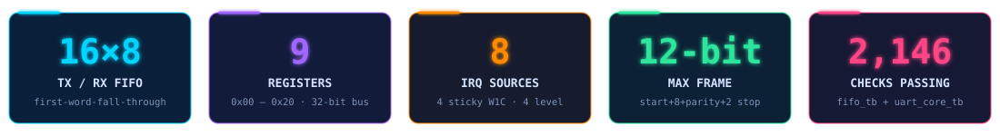

**[Overview](#overview) · [Architecture](#architecture) · [Registers](#register-map--programming-model) · [Frame](#frame-format) · [FSMs](#txrx-finite-state-machines) · [Interrupts](#interrupts) · [Quick start](#quick-start) · [Docs](#documentation)**

</div>


## Overview


A complete, CPU-attachable, synthesizable **8-bit UART peripheral** in plain Verilog-2001. It pairs a runtime-programmable baud generator and TX/RX serial engines with synchronous **16-entry TX and RX FIFOs**, a **memory-mapped 32-bit register bus**, and an **8-source interrupt controller** (4 sticky write-1-to-clear events + 4 live FIFO-level mirrors). Parity mode, stop-bit count and baud divisor are all reconfigurable at runtime with no re-synthesis.


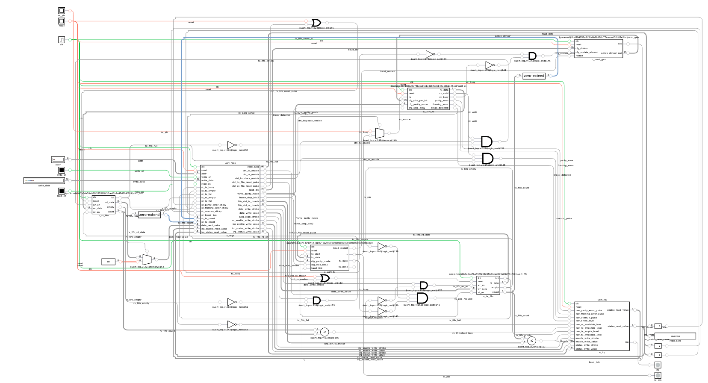

<div align = "center">
Raw netlist view of the auto-generated Yosys / DigitalJS schematic of the design
</div>

<br>

To explore the live, interactive simulation: **[https://digitaljs.tilk.eu/#5f3e7e647d347929a18dbd11ecd12d95ba588d162089a7ba57c0db6864906363](https://digitaljs.tilk.eu/#5f3e7e647d347929a18dbd11ecd12d95ba588d162089a7ba57c0db6864906363)**


## Features

| Capability | Detail |
|---|---|
| **8 data bits, LSB-first** | Start bit, 8 data bits, optional parity, **1 or 2 stop bits** (frames of 10 - 12 bits) |
| **Runtime framing & baud** | `PARITY_MODE` (`NONE`/`EVEN`/`ODD`) and `STOP_BITS2` in `FRAME_CONFIG`; 16-bit `BAUD_DIV` (`CLKS_PER_BIT`). Config is latched once per frame, and baud changes apply only while the link is idle, so a mid-frame write can never corrupt a frame in flight |
| **Synchronous FIFOs** | Two instances of one generic `uart_fifo`: 8-bit x 16 (parameterised, power-of-two depth), **first-word-fall-through** reads, `count` / `full` / `empty`, software flush |
| **Interrupt controller** | `uart_irq`: 4 sticky events (`PARITY_ERROR`, `FRAMING_ERROR`, `OVERRUN`, `BREAK`; W1C, *set wins* over a same-cycle clear) + 4 level mirrors (`RX_AVAILABLE`, `RX_THRESHOLD`, `TX_EMPTY`, `TX_THRESHOLD`) |
| **Error & break detection** | Parity, framing (stop bit != 1) and a free-running low-run counter that separates a true line break from a start bit or framing error; `STATUS.BREAK` shows the live level, `IRQ_STATUS.BREAK` the latched event |
| **Overrun-safe RX** | A byte arriving with the RX FIFO full is dropped and flagged; existing FIFO contents are untouched |
| **Internal loopback** | `CONTROL.LOOPBACK_ENABLE` routes `tx_pin` into `uart_rx`, exercising the full TX to RX path, FIFOs included |
| **CDC-conscious input** | 2-flip-flop synchronizer on the only asynchronous input (`rx_pin`); one clock domain everywhere else |
| **Zero-wait-state bus** | Combinational reads, registered writes, `ready` tied high |
| **One-command regression** | `make regression` --> `fifo_tb` + `uart_core_tb`, **2,146 self-checking checks** |


## Table of contents

- [Overview](#overview)
- [Features](#features)
- [Architecture](#architecture)
- [Register map & programming model](#register-map--programming-model)
- [Frame format](#frame-format)
- [TX / RX finite state machines](#txrx-finite-state-machines)
- [Interrupts](#interrupts)
- [FIFOs](#fifos)
- [Quick start](#quick-start)
- [Repository layout](#repository-layout)
- [Design philosophy](#design-philosophy)
- [Project history](#project-history)
- [Documentation](#documentation)


## Architecture

The diagram above shows the whole peripheral: the host talks to `uart_regs` over a flat bus; software `DATA` writes feed the **TX FIFO**, which `uart_top` drains into `uart_tx` automatically; `uart_rx` pushes validated bytes into the **RX FIFO**; `baud_gen` supplies a frame-stable timing reference to both engines; and `uart_irq` folds errors and FIFO levels into one `irq` pin.


<p align="center">
  
</p>

**`uart_top` interface**

| Port | Dir | Width | Purpose |
|---|---|---|---|
| `clk` | in | 1 | System clock (single clock domain) |
| `reset` | in | 1 | Synchronous, active-high |
| `addr` | in | 8 | Byte address, word-aligned |
| `write_en` / `write_data` | in | 1 / 32 | Registered write |
| `read_en` / `read_data` | in / out | 1 / 32 | Combinational read |
| `ready` | out | 1 | Tied `1'b1` (kept as a real port for future wait states) |
| `tx_pin` / `rx_pin` | out / in | 1 / 1 | Serial line |
| `irq` | out | 1 | Level, active-high |

Parameters: `FIFO_DEPTH = 16` · `BAUD_DIV_RESET = 434` (50 MHz / 115200) · `CLKS_PER_BIT_MAX = 4096`.

| Module | File | Responsibility |
|---|---|---|
| `uart_top` | `rtl/uart_top.v` | Integration: wires everything, owns TX/RX FIFO auto-feed, loopback mux and overrun detection |
| `uart_regs` | `rtl/uart_regs.v` | Register storage/decode for `CONTROL`, `BAUD_DIV`, `FRAME_CONFIG`, `FIFO_CONTROL`, plus the read side of `STATUS` / `FIFO_STATUS` |
| `uart_fifo` | `rtl/uart_fifo.v` | Generic parameterised synchronous FIFO (`DATA_WIDTH`, `DEPTH`), FWFT read, UART-agnostic |
| `uart_irq` | `rtl/uart_irq.v` | `IRQ_STATUS` storage (sticky + level mirror per source) and the `IRQ_ENABLE`-gated `irq` output |
| `baud_gen` | `rtl/baud_gen.v` | Bit-timing generator; loads a new divisor only while idle, exports the frame-stable `active_divisor` |
| `uart_tx` | `rtl/uart_tx.v` | Serializes start / data / optional parity / 1–2 stop bits; latches parity + stop config per frame |
| `uart_rx` | `rtl/uart_rx.v` | Deserializes, centre-samples each field, checks parity & stop bit(s), free-running break detector |
| `uart_defs.vh` | `rtl/uart_defs.vh` | Single source of truth: register offsets, bit fields, parity encoding (included by RTL *and* testbenches) |


## Register map & programming model

32-bit data bus, byte addresses, word-aligned, single cycle, no wait states. **Reads are combinational, writes are registered.**

<p align="center">
  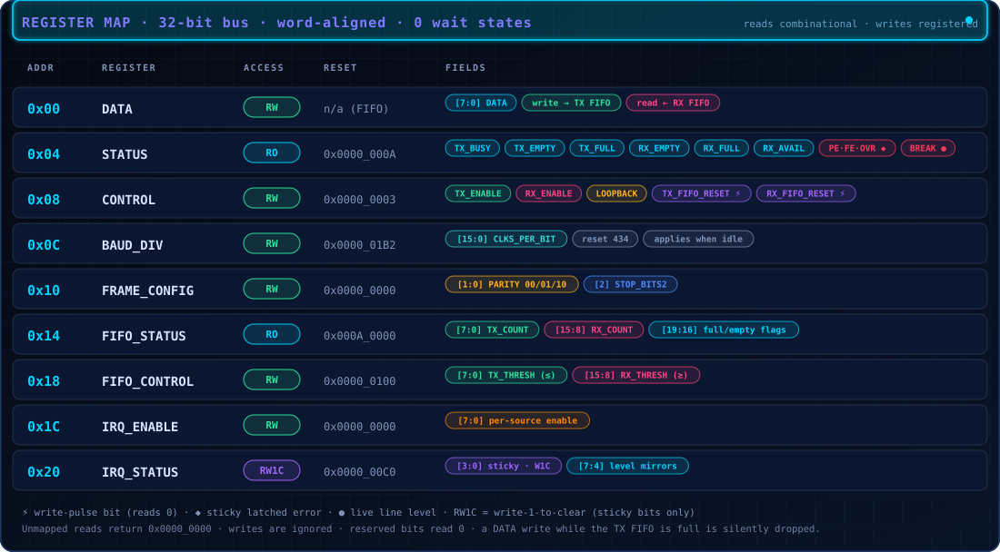
</p>

| Offset | Name | Access | Reset | Description |
|---|---|---|---|---|
| `0x00` | `DATA` | RW | n/a (FIFO) | `[7:0]` write pushes into the TX FIFO (dropped if full); read pops the RX FIFO (`0x00` if empty) |
| `0x04` | `STATUS` | RO | `0x0000_000A` | `[0]` `TX_BUSY` · `[1]` `TX_EMPTY` · `[2]` `TX_FULL` · `[3]` `RX_EMPTY` · `[4]` `RX_FULL` · `[5]` `RX_DATA_AVAILABLE` · `[6]` `PARITY_ERROR` (sticky) · `[7]` `FRAMING_ERROR` (sticky) · `[8]` `OVERRUN` (sticky) · `[9]` `BREAK` (**live level**) |
| `0x08` | `CONTROL` | RW | `0x0000_0003` | `[0]` `TX_ENABLE` · `[1]` `RX_ENABLE` · `[2]` `LOOPBACK_ENABLE` · `[3]` `TX_FIFO_RESET` (pulse) · `[4]` `RX_FIFO_RESET` (pulse) |
| `0x0C` | `BAUD_DIV` | RW | `0x0000_01B2` (434) | `[15:0]` `CLKS_PER_BIT`; software computes `CLK_FREQ_HZ / baud` |
| `0x10` | `FRAME_CONFIG` | RW | `0x0000_0000` | `[1:0]` `PARITY_MODE` (`00` NONE · `01` EVEN · `10` ODD · `11` reserved = NONE) · `[2]` `STOP_BITS2` |
| `0x14` | `FIFO_STATUS` | RO | `0x000A_0000` | `[7:0]` `TX_COUNT` · `[15:8]` `RX_COUNT` · `[16]` `TX_FULL` · `[17]` `TX_EMPTY` · `[18]` `RX_FULL` · `[19]` `RX_EMPTY` |
| `0x18` | `FIFO_CONTROL` | RW | `0x0000_0100` | `[7:0]` `TX_THRESH` (irq when `TX_COUNT <= TX_THRESH`) · `[15:8]` `RX_THRESH` (irq when `RX_COUNT >= RX_THRESH`) |
| `0x1C` | `IRQ_ENABLE` | RW | `0x0000_0000` | `[7:0]` per-source enable (`1` = enabled) |
| `0x20` | `IRQ_STATUS` | RW1C | `0x0000_00C0` | `[0]` `PARITY_ERROR` · `[1]` `FRAMING_ERROR` · `[2]` `OVERRUN` · `[3]` `BREAK` (all sticky, W1C) · `[4]` `RX_AVAILABLE` · `[5]` `RX_THRESHOLD` · `[6]` `TX_EMPTY` · `[7]` `TX_THRESHOLD` (live level mirrors, write-1 ignored) |

Unmapped reads return `0x0000_0000`; unmapped writes are ignored; reserved bits read `0`. Full field-by-field detail: [`docs/register_map.md`](docs/register_map.md).

### Key hardware behaviors

- **TX auto-drain, same-cycle pop.** `tx_pop_request = TX_ENABLE && !tx_empty && !tx_busy`. Because the FIFO is first-word-fall-through, `rd_data` already shows the byte being popped, so the pop and `tx_start` fire on the **same cycle**. `uart_tx` raising `tx_busy` removes the request on the next cycle, so one FIFO entry produces exactly one frame.
- **Frame-stable timing.** `baud_gen` only loads a new `BAUD_DIV` while `!tx_busy && !rx_busy`, and `uart_rx` is fed from its protected `active_divisor` — never the raw register. Parity and stop-bit config are latched at frame start (TX: on `tx_start`; RX: when the start bit is confirmed).
- **Overrun preserves data.** A validated byte arriving while the RX FIFO is full is discarded and raises `OVERRUN`; the bytes already queued stay intact and in order.
- **Set wins on W1C.** If an event lands on the exact cycle software clears the same sticky bit, the bit ends set. Hence, a brand-new event is never swallowed.
- **Two views of BREAK.** `STATUS.BREAK` is the live level (`1` while the line is held low past the threshold); `IRQ_STATUS.BREAK` is a latched edge event cleared by W1C — one break, however long, produces one interrupt.


## Frame format

<p align="center">
  
</p>

- Idle line level is `1`; a frame begins the instant the line falls to `0`.
- Parity is present only when `FRAME_CONFIG[1:0]` is `01` (EVEN) or `10` (ODD). A second stop bit is added when `FRAME_CONFIG[2]` is set.
- Every field lasts `CLKS_PER_BIT` (= `BAUD_DIV`) clock cycles and is centre-sampled by the receiver.
- Frame length: **10 bits** (8-N-1) up to **12 bits** (8-E-2 / 8-O-2).


## TX / RX finite state machines

<p align="center">
  
</p>

`break_detected` comes from a **separate, free-running counter** (`low_run_count`) that tracks how long the synchronized `rx` line has been continuously low. Its threshold is sized for the longest frame the receiver can be configured for, so a legal frame can never be mistaken for a break.

<details>
<summary><b>Mermaid state diagrams</b></summary>

<table>
<tr><th>Transmitter (<code>uart_tx.v</code>)</th><th>Receiver (<code>uart_rx.v</code>)</th></tr>
<tr><td>

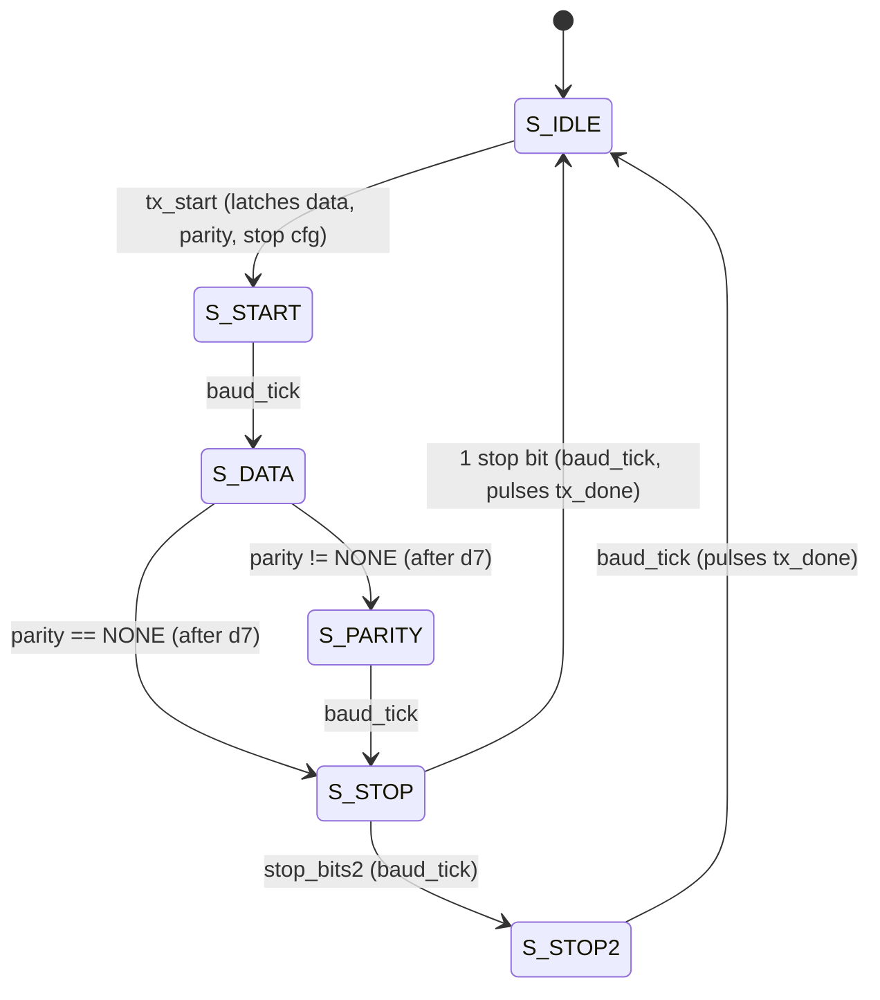

</td><td>

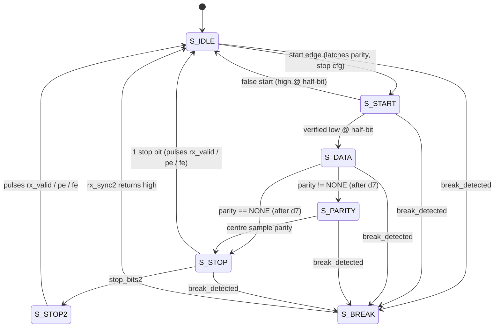

</td></tr>
</table>

</details>


## Interrupts

<p align="center">
  
</p>

`irq = OR over i of (IRQ_STATUS[i] & IRQ_ENABLE[i])` are computed combinationally. Sticky sources latch an event until software writes `1` to clear it; level sources mirror a live FIFO condition and are cleared only by changing that condition. Details and the per-source table: [`docs/interrupts.md`](docs/interrupts.md).


## FIFOs

<p align="center">
  
</p>

Both FIFOs are the same `uart_fifo` (8-bit × 16). Pointers carry one extra wrap bit for unambiguous `full` / `empty`, which is why `DEPTH` must be a power of two (checked at elaboration). Details: [`docs/fifo.md`](docs/fifo.md).


## Quick start

### Programming the peripheral

```c
// Offsets from the base address your interconnect assigns to uart_top
enum { DATA = 0x00, STATUS = 0x04, CONTROL = 0x08, BAUD_DIV = 0x0C, FRAME_CONFIG = 0x10,
       FIFO_STATUS = 0x14, FIFO_CONTROL = 0x18, IRQ_ENABLE = 0x1C, IRQ_STATUS = 0x20 };

// 1. configure (BAUD_DIV applies once the link is idle)
reg_write(BAUD_DIV,     CLK_FREQ_HZ / 115200);   // 50 MHz -> 434 (reset default)
reg_write(FRAME_CONFIG, (1 << 2) | 0x1);         // 8-E-2: STOP_BITS2 + EVEN parity
reg_write(FIFO_CONTROL, (4 << 8) | 0);           // RX_THRESH = 4, TX_THRESH = 0
reg_write(CONTROL,      0x3);                    // TX_ENABLE | RX_ENABLE
reg_write(IRQ_ENABLE,   (1 << 5) | 0x0F);        // RX_THRESHOLD + the four error events

// 2. transmit: queue a byte (TX_FULL is STATUS[2])
while (reg_read(STATUS) & (1 << 2)) ;
reg_write(DATA, byte);

// 3. receive: RX_EMPTY is STATUS[3]; reading DATA pops the FIFO
if (!(reg_read(STATUS) & (1 << 3)))
    byte = reg_read(DATA) & 0xFF;

// 4. acknowledge sticky errors (write-1-to-clear, bits [3:0] only)
uint32_t s = reg_read(IRQ_STATUS);
if (s & 0x0F) reg_write(IRQ_STATUS, s & 0x0F);
```

### Simulate, lint, synthesize

Requires [Icarus Verilog](http://iverilog.icarus.com/), [Verilator](https://www.veripool.org/verilator/) and [Yosys](https://yosyshq.net/yosys/) (all open source)

```sh
git clone https://github.com/TharinduHimantha/8-bit-UART-Communication-System-in-Verilog-HDL.git
cd 8-bit-UART-Communication-System-in-Verilog-HDL

make regression               # fifo_tb + uart_core_tb, one combined pass/fail summary
make lint                     # Verilator --lint-only -Wall over all RTL
make synth                    # Yosys generic synthesis check
make waves TB=uart_core_tb    # dump a VCD waveform for a testbench
make clean                    # remove build artifacts
```

<p align="center">
  
  <br><sub>Illustrative rendering of the results documented in <a href="docs/verification.md"><code>docs/verification.md</code></a>.</sub>
</p>


## Repository layout

```
UART-Project/
│
├── rtl/                              # RTL design source files
│   ├── uart_defs.vh                  # Shared definitions: register map, bit fields,
│   │                                 # and parity encoding
│   ├── baud_gen.v                    # Runtime-configurable baud-rate generator
│   ├── uart_tx.v                     # UART transmitter with configurable parity
│   │                                 # and 1- or 2-stop-bit support
│   ├── uart_rx.v                     # UART receiver with parity checking,
│   │                                 # framing-error and break detection
│   ├── uart_fifo.v                   # Parameterized synchronous FIFO
│   │                                 # with First-Word Fall-Through (FWFT)
│   ├── uart_regs.v                   # Memory-mapped register storage and decoding
│   ├── uart_irq.v                    # Interrupt controller and source management
│   └── uart_top.v                    # Top-level UART integration module
│
├── tb/                               # Verification environment
│   ├── uart_tasks.v                  # Shared verification tasks, register-bus
│   │                                 # driver, assertions, and parity reference model
│   ├── fifo_tb.v                     # Standalone FIFO verification testbench
│   │                                 # (2,014 checks)
│   └── uart_core_tb.v                # Full UART integration testbench
│                                     # (132 checks)
│
├── scripts/                          # Automation and design validation
│   └── synth_check.sh                # Yosys-based generic synthesis,
│                                     # latch-inference and structural checks
│
├── docs/                              # Technical documentation
│   ├── assets/                        # Animated SVG diagrams and visual assets
│   ├── schematic-diagram.png         # Synthesized netlist visualization
│   ├── architecture.md               # Module overview, data paths,
│   │                                 # reset architecture, and design review
│   ├── register_map.md               # Register definitions, bit-field tables,
│   │                                 # access protocol, and safety rules
│   ├── fifo.md                       # FIFO operation, FWFT behavior,
│   │                                 # and power-of-two design rationale
│   ├── interrupts.md                 # Interrupt architecture and
│   │                                 # per-source behavior and semantics
│   ├── timing.md                     # Baud-rate calculations, throughput,
│   │                                 # latency, and buffering analysis
│   └── verification.md               # Verification methodology, test matrix,
│                                     # coverage summary, and lessons learned
│
├── early-phases/                     # Historical design snapshots
│   ├── CHANGELOG.md                  # Evolution of the UART design
│   │                                 # across development phases
│   ├── phase1_reference/             # Phase 1 baseline implementation
│   └── phase2_reference/             # Phase 2 intermediate implementation
│
├── .github/
│   └── workflows/
│       └── ci.yml                    # Automated continuous-integration workflow
│
├── Makefile                          # Build, simulation, and verification targets
├── README.md                         # Project overview, features, and usage guide
├── LICENSE                           # Project licensing information
└── .gitignore                        # Git exclusion rules
```


## Design philosophy

- **Strict separation of concerns.** The serial engines (`uart_tx`, `uart_rx`, `baud_gen`) know nothing about bus addresses or FIFOs; `uart_fifo` knows nothing about UART frames; `uart_irq` is a pure event/mask matrix; `uart_regs` does address decode; `uart_top` only glues them together.
- **Frame-boundary latching.** Parity, stop bits and baud divisor are sampled at the start of a frame (baud: only while idle), so configuration changes are deterministic and can never split a frame across two settings. A real RX-side gap in this protection was found by a directed test and fixed — see [`docs/verification.md`](docs/verification.md).
- **Sticky vs. level, on purpose.** One-shot *events* latch until acknowledged; *conditions* mirror live state. Mixing the two would make "clear" either meaningless or misleading.
- **FWFT everywhere.** A combinational peek of the FIFO head removes an entire class of read-latency bugs at every call site, and lets the TX pop and start fire on the same cycle.
- **No ambiguity in hardware/software contracts.** Same cycle push+pop at full/empty, same-cycle event vs. W1C, unmapped addresses, reserved bits and threshold edge cases (`0`, `DEPTH`, `> DEPTH`) are each specified *and* individually tested.


## Project history


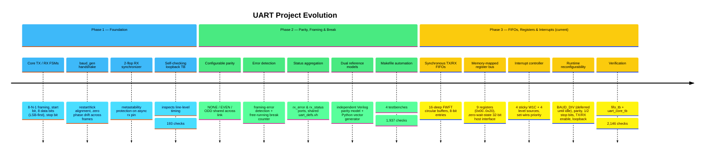

| Capability | Phase 1 : Foundation | Phase 2 : Parity, Framing & Break | Phase 3 : FIFOs, Regs & IRQs *(current)* |
|---|---|---|---|
| **Framing & parity** | Fixed 8-N-1 | Compile-time parity (`NONE`/`EVEN`/`ODD`) | **Runtime** `FRAME_CONFIG`: parity + 1/2 stop bits |
| **Baud rate** | Compile-time `CLKS_PER_BIT` | Compile-time `CLKS_PER_BIT` | **Runtime** 16-bit `BAUD_DIV`, applied when idle |
| **Buffering** | Single holding register | Single holding register | **16-entry TX FIFO & 16-entry RX FIFO** (8-bit, FWFT) |
| **Error handling** | None | Pin-level parity / framing / break | **Sticky `PARITY_ERROR`, `FRAMING_ERROR`, `OVERRUN`, `BREAK`** + live `STATUS.BREAK` |
| **Host interface** | Raw wires | Raw wires + status bits | **32-bit memory-mapped register file (`0x00..0x20`)** |
| **Interrupts** | Polling only | Pin-level strobes | **8-source maskable `uart_irq` (4 sticky W1C + 4 level)** |
| **Loopback** | External wire in testbench | External wire in testbench | **Software `CONTROL.LOOPBACK_ENABLE`** |
| **Verification** | 1 testbench (193 checks) | 4 testbenches (1,937 checks) | **`fifo_tb` + `uart_core_tb` (2,146 checks)** |

The original early phases snapshots are preserved under [`early-phases/`](early-phases/). See [`CHANGELOG.md`](early-phases/CHANGELOG.md) for the complete phase through phase breakdown.


## Documentation


| Document | Covers |
|---|---|
| [`docs/architecture.md`](docs/architecture.md) | Module inventory, data paths, TX/RX FIFO auto-feed, deferred baud update, reset architecture, CDC, and an end-of-project architecture review |
| [`docs/register_map.md`](docs/register_map.md) | Every register and bit field, access protocol, unmapped / reserved / read-only behavior |
| [`docs/fifo.md`](docs/fifo.md) | FIFO semantics table, why depth must be a power of two, why reads are first-word-fall-through |
| [`docs/interrupts.md`](docs/interrupts.md) | Interrupt architecture, the sticky-vs-level split, per-source semantics table |
| [`docs/timing.md`](docs/timing.md) | Baud-rate math and error, metastability, throughput / latency / buffering calculations |
| [`docs/verification.md`](docs/verification.md) | Test architecture, reference models, fault injection, the full test matrix, lessons learned, known limitations |
| [`early-phases/CHANGELOG.md`](early-phases/CHANGELOG.md) | Project history across development phases |


