# FIFO Architecture

<p align="center"></p>

<p align="center"><sub>[README](../README.md) · [Architecture](architecture.md) · [Registers](register_map.md) · **FIFO** · [Interrupts](interrupts.md) · [Timing](timing.md) · [Verification](verification.md)</sub></p>

`rtl/uart_fifo.v` is a generic, reusable synchronous FIFO. It has no
knowledge of UART bytes, frames, or serial timing whatsoever -- it is
instantiated twice in `uart_top.v` (TX FIFO, RX FIFO) with identical
parameters, and could equally be reused in a completely unrelated
project.

<p align="center">
  
</p>

## Parameters

| Parameter    | Description |
|--------------|-------------|
| `DATA_WIDTH` | Width of each entry, in bits. `8` in this project. |
| `DEPTH`      | Number of entries. **Must be a power of two** (see below). `16` by default in `uart_top.v`. |

## Interface

```verilog
module uart_fifo #(
    parameter integer DATA_WIDTH = 8,
    parameter integer DEPTH      = 16
) (
    input  wire                    clk,
    input  wire                    reset,   // synchronous, active-high

    input  wire                    wr_en,
    input  wire [DATA_WIDTH-1:0]   wr_data,
    output wire                    full,

    input  wire                    rd_en,
    output wire [DATA_WIDTH-1:0]   rd_data, // first-word-fall-through (see below)
    output wire                    empty,

    output wire [$clog2(DEPTH+1)-1:0] count
);
```

## Why `DEPTH` must be a power of two, explained (not just asserted)

The full/empty logic uses the standard "one extra pointer bit" technique:
the read and write pointers are each `$clog2(DEPTH)+1` bits wide -- one
bit *wider* than needed to index the `DEPTH`-entry memory array.

```
empty = (wr_ptr == rd_ptr)                                   // pointers fully equal
full  = (wr_ptr[MSB] != rd_ptr[MSB]) && (wr_ptr[LSBs] == rd_ptr[LSBs])
        // same memory index, but the write pointer has wrapped
        // one more time than the read pointer
```

This only produces unambiguous full/empty detection when the pointer's
lower bits (`ADDR_WIDTH = $clog2(DEPTH)` bits) index the memory array
*exactly*, with no unused address values. If `DEPTH` were not a power of
two, the pointer would either waste addressable range (if `DEPTH` were
rounded up to the next power of two internally, silently allocating more
memory than requested) or the wrap-bit comparison above would become
ambiguous at the unused addresses (if it were not rounded up). Rather
than pick one of those silently, `uart_fifo.v` uses an elaboration-time
check:

```verilog
generate
    if ((DEPTH == 0) || ((DEPTH & (DEPTH - 1)) != 0)) begin : g_depth_check
        $error("uart_fifo: DEPTH must be a nonzero power of two (got %0d)", DEPTH);
    end
endgenerate
```

`(DEPTH & (DEPTH - 1)) == 0` is the standard bit-trick test for "is this
a power of two" (a power of two has exactly one set bit; subtracting one
flips every bit below it, so ANDing the two together is zero only for
powers of two -- and the explicit `DEPTH == 0` check exists because that
trick alone would incorrectly accept zero).

> [!NOTE]
> **A modulo-based alternative that would support arbitrary depths was
> considered and rejected.** It would replace the free wrap-bit comparison
> above with explicit modulo arithmetic on every pointer increment (or an
> explicit `count` register incremented/decremented on every operation
> instead of derived from pointer subtraction), adding real arithmetic cost
> for a capability this project's actual `DEPTH` values (always powers of
> two by choice) never need. Failing loudly at elaboration time for an
> unsupported `DEPTH`, rather than silently synthesizing subtly-incorrect
> full/empty logic, was judged the better tradeoff.


## Read side: first-word-fall-through (FWFT), and why

`rd_data` is a **combinational peek** of the current front-of-queue
entry (`0` when the FIFO is empty), visible at all times with zero extra
latency. It does **not** require `rd_en` to be asserted to be valid, and
does **not** lag a pop by a cycle. `rd_en`'s only job is to *advance* the
read pointer -- to discard the entry currently being peeked and reveal
the next one.

This was not the first design tried. An earlier version used a
registered read (`rd_data` updating one cycle *after* `rd_en`, i.e. a
pipelined pop-then-see-result-next-cycle style, which is also a
completely standard and valid FIFO design). It was changed to FWFT after
a concrete bug was found during development: the register-interface
`DATA` read (see `docs/register_map.md`) is a single-cycle,
no-wait-states combinational operation by design -- but with the
registered-read FIFO, the combinational `read_data` mux built on top of
it returned the *previous* popped byte, not the one being popped this
cycle, because the FIFO's own output hadn't caught up yet. FWFT
eliminates this entire bug class at every call site that reads the FIFO,
not just the one where it was first noticed -- which is also why
`uart_top.v`'s TX auto-feed logic (see `docs/architecture.md`) is
simpler than an early draft of it needed to be: with FWFT, `tx_start` and
the FIFO pop can fire on the exact same cycle, with no pipeline-delay
register required to bridge a read latency that no longer exists.

## Complete semantics

| Scenario | Behavior |
|----------|----------|
| `wr_en && full` | Write **ignored**. Data is not written, `wr_ptr` does not advance, `count` does not change. This is a silent drop from the FIFO's own point of view; the caller (`uart_top.v`) is responsible for surfacing this as an overrun/overflow condition if it cares to (see `docs/interrupts.md`) -- the FIFO itself has no concept of "error," only "did the operation happen." |
| `rd_en && empty` | The pointer-advance is ignored (nothing to advance past). `rd_data` already reads `0` per the FWFT rule. |
| `wr_en && rd_en`, neither full nor empty | **Both happen** in the same cycle: one entry is written, one entry (the one already at the front, per FWFT -- *not* the one just written this cycle) is popped. `count` is unchanged (one in, one out). No special-cased "simultaneous" branch exists in the RTL for this -- the write-pointer-advance and read-pointer-advance logic run independently, and this case simply falls out correctly because the two pointers are genuinely independent state. |
| `wr_en && rd_en`, FIFO full | Write is ignored (per the full rule); read succeeds (FIFO is not empty). Nets to one entry leaving and none entering: `count` decreases by one. |
| `wr_en && rd_en`, FIFO empty | Symmetric: read is ignored; write succeeds. `count` increases by one. |
| `reset` while active (any occupancy) | Both pointers synchronously clear to 0. `empty` becomes true, `full` becomes false, `count` becomes 0, all in the same cycle reset is sampled. Memory contents are not explicitly cleared (nothing reads them until a subsequent write, at which point the old contents are irrelevant). |

## What's verified

`tb/fifo_tb.v` is a standalone testbench (no UART logic involved at all)
that directly exercises every row of the table above, plus:

- reset, first write, first read, completely full, completely empty
- write to a full FIFO (ignored, checked via `count`/`full` unchanged)
- read from an empty FIFO (ignored, checked via `count`/`empty`
  unchanged, `rd_data` reads `0`)
- pointer wraparound across many fill/drain cycles (`DEPTH * 6`
  iterations, guaranteeing the internal pointers wrap past their maximum
  value at least once)
- all three simultaneous-read/write cases from the table above,
  individually
- reset while partially full
- 500 iterations of fully randomized traffic (random write-enable,
  read-enable, and data every cycle), checked against an independent
  software reference queue implemented directly in the testbench (a
  plain Verilog array used purely as an oracle, following the exact
  semantics documented above, computed independently rather than by
  reading the DUT's own internal pointers)

As of the last run against this exact source (Icarus Verilog 12.0):
**2014 / 2014 checks passed.**
