# Interrupt Subsystem

<p align="center"></p>

<p align="center"><sub>[README](../README.md) · [Architecture](architecture.md) · [Registers](register_map.md) · [FIFO](fifo.md) · **Interrupts** · [Timing](timing.md) · [Verification](verification.md)</sub></p>

All interrupt generation is centralized in one module, `rtl/uart_irq.v`.
No other module in this project decides "should the `irq` pin be
asserted" -- `uart_tx.v` and `uart_rx.v` only ever produce raw event
signals (a parity-error pulse, a framing-error pulse, a break level), and
`uart_top.v` only ever wires those raw signals, plus a couple of FIFO-
derived conditions it computes itself (overrun, threshold comparisons),
into `uart_irq.v`'s inputs. This centralization is deliberate, per the
assignment's explicit instruction not to scatter interrupt generation
throughout unrelated modules.

<p align="center">
  
</p>

## Architecture

```
raw event/condition          IRQ_STATUS               IRQ_ENABLE
      │                          │                          │
      ▼                          ▼                          │
 (see table below,          (storage: sticky            (plain RW
  per-source rule)           latch OR live                storage)
      │                       mirror, per                    │
      │                       source -- see                  │
      │                       below)                          │
      └──────────────┬────────────┘                            │
                      ▼                                        │
                     AND  ◄──────────────────────────────────────┘
                      │
                      ▼
                    OR (across all 8 sources)
                      │
                      ▼
                     irq
```

`irq = OR over i in 0..7 of (IRQ_STATUS[i] & IRQ_ENABLE[i])` -- exactly
the architecture the assignment suggests as an example, implemented
literally.

## Two deliberately different behaviors, and why

> [!IMPORTANT]
> **This project does NOT use one uniform interrupt behavior for all 8
> sources.** That was a deliberate choice, not an oversight, made because
> the 8 sources genuinely fall into two different categories of thing:


### Category 1: sticky, edge-latched, write-1-to-clear (bits 0-3)

`PARITY_ERROR`, `FRAMING_ERROR`, `OVERRUN`, `BREAK`.

These are one-shot **events**. Once the underlying condition pulses (or,
for `BREAK` specifically, transitions from low to high -- see below), the
corresponding `IRQ_STATUS` bit latches to `1` and **stays there**,
regardless of what the underlying condition does next, until software
explicitly writes a `1` to that bit to acknowledge it.

This is the correct behavior for events because an event can otherwise be
missed entirely: a parity error that lasts exactly one clock cycle could
never be reliably observed by software polling on its own schedule if the
status bit didn't persist.

`BREAK` is a level signal at its source (`uart_rx.v`'s `break_detected`
output stays high for the entire duration the line is held low past the
threshold), but `IRQ_STATUS[3]` is still sticky/edge-latched, not a live
mirror of that level. `uart_irq.v` internally edge-detects the level
(`raw_break_pulse = raw_break_level && !break_level_prev`) specifically
so a single break condition -- however long it lasts -- produces exactly
one latch event, cleared exactly once by software, rather than
continuously re-triggering for as long as the line stays low. The live
level itself is still directly observable, separately, via
`STATUS.BREAK` (see `docs/register_map.md`) -- the two registers
deliberately expose two different pieces of information ("is a break
happening right now" vs. "has a break event occurred since I last
acknowledged one") rather than duplicating the same state twice.

> [!TIP]
> **Simultaneous set-and-clear**: if a new event pulse arrives on the exact
> same cycle software writes a `1` to clear that same bit, the RTL gives
> the new event priority (the bit ends that cycle set to `1`, not `0`).
> This is the safer choice: software's write was clearing a *previous*
> occurrence it already knew about, and a brand new occurrence arriving in
> that same instant should not be silently swallowed.


### Category 2: live, level-mirrored, not clearable by writing (bits 4-7)

`RX_AVAILABLE`, `RX_THRESHOLD`, `TX_EMPTY`, `TX_THRESHOLD`.

These directly reflect a **current, ongoing condition** (e.g. "the RX
FIFO currently has at least one byte in it"). Making these sticky and
clearable would be actively misleading: if software "cleared" a bit whose
underlying condition was still true, the interrupt would either
immediately reassert (if the hardware re-latched it combinationally,
making the "clear" pointless) or, worse, silently disappear until some
unrelated future edge re-triggered the latch -- and either behavior would
misrepresent whether the condition is actually still true.

The correct, unambiguous way to make one of these interrupts go away is
to change the underlying condition: drain the RX FIFO below its
threshold, or fill the TX FIFO above its threshold. **Writing `1` to one
of bits 4-7 in `IRQ_STATUS` is therefore defined to have no effect at
all**, and this is not left as an unstated assumption -- it is directly
exercised by a named test in `tb/uart_core_tb.v`
("IRQ: write-1 to a level-mirror bit has no lasting effect").

## Per-source semantics table

| Bit | Source | Trigger condition | Pending behavior | Sensitivity | Sticky? | Clear mechanism |
|-----|--------|--------------------|--------------------|-------------|---------|-------------------|
| 0 | PARITY_ERROR  | `uart_rx` parity mismatch on a completed frame | Latches on the pulse | Edge (pulse) | Yes | Write 1 to `IRQ_STATUS[0]` |
| 1 | FRAMING_ERROR | `uart_rx` bad stop bit on a completed frame | Latches on the pulse | Edge (pulse) | Yes | Write 1 to `IRQ_STATUS[1]` |
| 2 | OVERRUN       | A validated byte arrives while the RX FIFO is full | Latches on the pulse | Edge (pulse) | Yes | Write 1 to `IRQ_STATUS[2]` |
| 3 | BREAK         | `uart_rx.break_detected` transitions 0->1 | Latches on the transition | Edge (internally detected from a level) | Yes | Write 1 to `IRQ_STATUS[3]` |
| 4 | RX_AVAILABLE  | RX FIFO count >= 1 | Continuously reflects current state | Level | No | Drain the RX FIFO below 1 entry |
| 5 | RX_THRESHOLD  | RX FIFO count >= `FIFO_CONTROL.RX_THRESH` | Continuously reflects current state | Level | No | Drain the RX FIFO below the threshold |
| 6 | TX_EMPTY      | TX FIFO count == 0 | Continuously reflects current state | Level | No | Write more data into the TX FIFO |
| 7 | TX_THRESHOLD  | TX FIFO count <= `FIFO_CONTROL.TX_THRESH` | Continuously reflects current state | Level | No | Fill the TX FIFO above the threshold |

## Overrun, specifically

An overrun is detected when `uart_rx` produces a clean, validated byte
(`rx_valid`) at the exact moment the RX FIFO is already full. The new
byte is **discarded** -- there is nowhere to put it -- and the RX FIFO's
existing contents are **completely undisturbed**. This was verified
directly: `tb/uart_core_tb.v` fills the RX FIFO to exactly `FIFO_DEPTH`
known values, injects one more byte, confirms `OVERRUN` fires, then
drains the FIFO and confirms all `FIFO_DEPTH` original bytes are present,
in their original order, with the dropped byte appearing nowhere among
them.

## FIFO interrupt thresholds

See `docs/register_map.md`'s `FIFO_CONTROL` section for the exact,
off-by-one-free threshold semantics (including the `threshold=0`,
`threshold=1`, `threshold=DEPTH`, and `threshold>DEPTH` edge cases, all
individually verified in `tb/uart_core_tb.v`).

## What's verified

`tb/uart_core_tb.v`'s "INTERRUPT VERIFICATION" and "FIFO INTERRUPT
THRESHOLDS" sections cover, for multiple individual sources:

1. creating the underlying condition
2. verifying the live/sticky status bit
3. verifying the source is pending-but-produces-no-`irq`-output while
   disabled
4. enabling the source and verifying `irq` asserts
5. clearing (where applicable) and verifying `irq` deasserts
6. two simultaneous sticky sources, confirming clearing one leaves the
   other (and `irq`) still asserted, and clearing both deasserts `irq`
7. write-1-to-clear on a level-mirror bit having no effect

Reset-with-a-pending-interrupt is covered separately in the "RESET IN
VARIOUS STATES" section: `IRQ_ENABLE` and the sticky `IRQ_STATUS` bits
are confirmed to clear on reset, and `irq` is confirmed to deassert.
