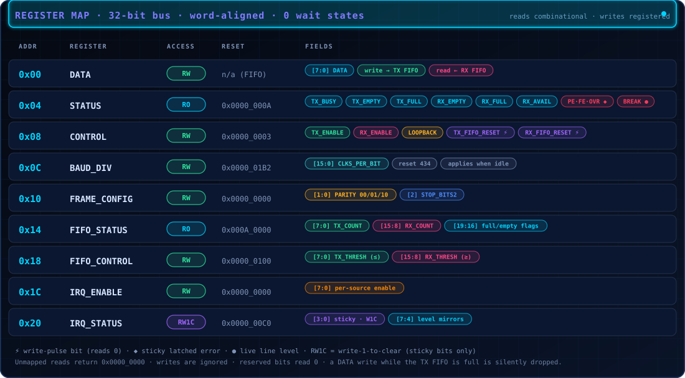

# Register Map

[README](../README.md) · [Architecture](architecture.md) · **Registers** · [FIFO](fifo.md) · [Interrupts](interrupts.md) · [Timing](timing.md) · [Verification](verification.md)

Every address and bit position in this document is sourced from
`rtl/uart_defs.vh`, which is the single file both the RTL and every
testbench actually `` `include ``. This document is a description of that
file, not an independent specification -- if the two ever disagreed, the
`.vh` file is what the hardware actually does, and this document would be
wrong. See `docs/architecture.md`'s consistency-review note for why this
matters enough to be stated explicitly.

  

## Register access protocol

- 32-bit data bus, byte addresses, word-aligned (4-byte stride).
- Single-cycle, no wait states: `ready` is tied to `1'b1` (see
  `uart_top.v`/`uart_regs.v`). `ready` is still a real port, not hidden
  away, specifically so a future version of this peripheral could
  introduce wait states without changing the interface any caller
  depends on.
- **Reads are combinational**: `read_data` reflects whatever `addr` and
  `read_en` currently select, with no registration delay.
- **Writes are registered (synchronous)**: a write takes effect on the
  clock edge at which `write_en` is high, using `write_data` sampled that
  same edge.
- **Unmapped addresses**: reads return `32'h0000_0000`; writes are
  silently ignored. There is no bus-error signal in this protocol -- see
  "Known limitations" in `docs/verification.md` for why that was judged
  unnecessary complexity for this project's scope rather than an
  oversight.
- **Reserved bits**, within a register that IS mapped: always read as
  `0`; writes to them are accepted (no error) but have no effect.

## Register table

| Address | Register       | Access | Reset Value  | Description                                    |
|---------|----------------|--------|--------------|-------------------------------------------------|
| 0x00    | DATA           | RW     | n/a (FIFO)   | Write pushes a byte into the TX FIFO; read pops a byte from the RX FIFO. |
| 0x04    | STATUS         | RO     | 0x0000_000A  | Live status: TX/RX busy/empty/full, sticky+live error flags. |
| 0x08    | CONTROL        | RW     | 0x0000_0003  | TX/RX enable, loopback enable, FIFO reset pulses. |
| 0x0C    | BAUD_DIV       | RW     | 0x0000_01B2  | Baud-rate divisor (`CLKS_PER_BIT`), 16 bits. (434 decimal, = 0x1B2) |
| 0x10    | FRAME_CONFIG   | RW     | 0x0000_0000  | Parity mode, stop-bit count.                   |
| 0x14    | FIFO_STATUS    | RO     | 0x000A_0000  | TX/RX FIFO counts and full/empty flags.        |
| 0x18    | FIFO_CONTROL   | RW     | 0x0000_0100  | TX/RX interrupt threshold configuration.       |
| 0x1C    | IRQ_ENABLE     | RW     | 0x0000_0000  | Per-source interrupt enable (8 sources).       |
| 0x20    | IRQ_STATUS     | RW1C*  | 0x0000_00C0  | Per-source interrupt status (see note below).  |

\* IRQ_STATUS is write-1-to-clear for its 4 sticky bits only; its 4
level-mirror bits are read-only in effect (a write of `1` to them is
accepted but has no effect) -- see `docs/interrupts.md` for the full
reasoning. Its reset value is `0xC0` because, immediately out of reset,
the TX FIFO genuinely is empty, and TX_EMPTY/TX_THRESHOLD (bits 6 and 7,
both live level mirrors) correctly reflect that true condition -- this is
accurate live state, not "uncleared" interrupt state; see
`docs/interrupts.md`.

## DATA (0x00)

| Bits | Field | Access | Reset | Description |
|------|-------|--------|-------|-------------|
| 7:0  | DATA  | RW     | n/a   | Write: pushed into the TX FIFO. Read: popped from the RX FIFO (first-word-fall-through: the value is valid combinationally at the moment of the read, not one cycle later). |
| 31:8 | -     | RO     | 0     | Reserved, reads 0. |

**Write while the TX FIFO is full**: the write is silently dropped (the
byte is never queued). No separate error bit is raised for this -- see
"Design decisions" below for why `STATUS.TX_FULL` was judged sufficient
on its own, given software could always check it first.

**Read while the RX FIFO is empty**: returns `0x00` (a well-defined,
deterministic value), and does not disturb the FIFO's read pointer.
`STATUS.RX_EMPTY` (or `RX_DATA_AVAILABLE`) is what tells software not to
trust a `0x00` read as if it were real data.

## STATUS (0x04) -- read-only

| Bit | Field              | Description |
|-----|--------------------|-------------|
| 0   | TX_BUSY            | 1 while a TX frame is actively being shifted out. |
| 1   | TX_EMPTY           | 1 when the TX FIFO is empty. |
| 2   | TX_FULL            | 1 when the TX FIFO is full. |
| 3   | RX_EMPTY           | 1 when the RX FIFO is empty. |
| 4   | RX_FULL            | 1 when the RX FIFO is full. |
| 5   | RX_DATA_AVAILABLE  | Convenience alias for `!RX_EMPTY`. |
| 6   | PARITY_ERROR       | Sticky (mirrors `IRQ_STATUS` bit 0). Set on a parity mismatch; cleared only by writing 1 to `IRQ_STATUS[0]`. |
| 7   | FRAMING_ERROR      | Sticky (mirrors `IRQ_STATUS` bit 1). Set on a bad stop bit; cleared only by writing 1 to `IRQ_STATUS[1]`. |
| 8   | OVERRUN            | Sticky (mirrors `IRQ_STATUS` bit 2). Set when a validated byte arrives with the RX FIFO already full; cleared only by writing 1 to `IRQ_STATUS[2]`. |
| 9   | BREAK              | **Live level**, NOT the sticky `IRQ_STATUS` break bit. Reflects `uart_rx`'s `break_detected` output directly: 1 for as long as the line is continuously held low past the break threshold, 0 the instant the line recovers. See `docs/interrupts.md` for why this is deliberately different from `IRQ_STATUS[3]` (a latched, sticky, write-1-clearable "a break event happened" bit). |
| 31:10 | -                | Reserved, reads 0. |

> [!TIP]
> **Reading STATUS never clears anything.** The only way to clear the
> sticky bits 6-8 (or the corresponding `IRQ_STATUS` sticky bits) is an
> explicit write-1-to-clear to `IRQ_STATUS`.

## CONTROL (0x08)

| Bit | Field              | Access | Reset | Description |
|-----|--------------------|--------|-------|-------------|
| 0   | TX_ENABLE          | RW     | 1     | 1: the TX FIFO is automatically drained into `uart_tx` as bytes become available. 0: bytes may still be written into the TX FIFO, but none are transmitted until re-enabled. |
| 1   | RX_ENABLE          | RW     | 1     | 1: validated received bytes are pushed into the RX FIFO. 0: `uart_rx` still runs and still detects/validates frames (and can still raise `parity_error`/`framing_error`/`break_detected`), but nothing is pushed into the RX FIFO -- see `docs/architecture.md`'s "Known limitations" for why this is a documented scoping choice rather than a full front-end power-down. |
| 2   | LOOPBACK_ENABLE    | RW     | 0     | 1: `uart_rx` listens to `uart_tx`'s own output internally instead of the external `rx_pin`. The external `tx_pin` is always driven regardless of this bit -- see `docs/architecture.md`. |
| 3   | TX_FIFO_RESET      | W-pulse| 0     | Writing 1 resets the TX FIFO (empties it) for one cycle; always reads back 0. |
| 4   | RX_FIFO_RESET      | W-pulse| 0     | Writing 1 resets the RX FIFO (empties it) for one cycle; always reads back 0. |
| 31:5| -                  | RO     | 0     | Reserved, reads 0. |

> [!NOTE]
> **Design decision: no `FIFO_ENABLE` bit.** The assignment's example
> register layout suggested one; it was deliberately not implemented. A
> real "bypass the FIFO entirely" mode would require an entirely separate,
> FIFO-less data path (or a FIFO forced to depth 1, which already exists as
> an option via the `FIFO_DEPTH` parameter at instantiation time) -- adding
> real design and verification complexity for a mode this project's target
> use case does not need. Per the assignment's own guidance ("if a bit is
> unnecessary, don't include it" / "choose the simpler architecture and
> explain the decision"), it was left out.

## BAUD_DIV (0x0C)

| Bits | Field    | Access | Reset | Description |
|------|----------|--------|-------|-------------|
| 15:0 | CLKS_PER_BIT | RW | 434  | The number of system clock cycles per UART bit period. Software computes this directly (`CLK_FREQ_HZ / desired_baud`, integer division) and writes the result -- there is no on-chip fractional baud generator; see `docs/timing.md` for the resulting error calculation. |
| 31:16| -        | RO     | 0     | Reserved, reads 0. |

> [!IMPORTANT]
> **Update policy while TX/RX is active**: **deferred until idle.** A write
> to `BAUD_DIV` is stored immediately (a subsequent read reflects it right
> away), but the actual bit-timing divisor used by `baud_gen` only loads
> the new value while both `TX_BUSY` and (the RX equivalent of) `TX_BUSY`
> are deasserted -- i.e. the change takes effect starting with the very
> next frame after the link goes idle, never partway through a frame in
> progress. This is deterministic and avoids a frame being timed partly at
> the old rate and partly at the new rate. See `docs/architecture.md` for
> the full derivation, including a bug this exact protection caught during
> development (RX was initially reading the *raw*, unprotected register
> value directly, rather than the deferred, frame-stable value -- see that
> document's "lessons learned").

## FRAME_CONFIG (0x10)

| Bits | Field       | Access | Reset | Description |
|------|-------------|--------|-------|-------------|
| 1:0  | PARITY_MODE | RW     | 00    | `00`=NONE, `01`=EVEN, `10`=ODD, `11` reserved (treated identically to NONE). |
| 2    | STOP_BITS2  | RW     | 0     | 0 = 1 stop bit, 1 = 2 stop bits. |
| 31:3 | -           | RO     | 0     | Reserved, reads 0. |

**Update policy**: like `BAUD_DIV`, changes are latched at the start of
each new frame (TX: the cycle `tx_start` is accepted; RX: the moment a
candidate start bit is confirmed real, not a glitch), so a `FRAME_CONFIG`
write mid-frame cannot corrupt a frame already in flight.

**DATA_BITS is not configurable via a register.** It is fixed at 8 bits
(a compile-time RTL parameter), per the assignment's explicit guidance
not to add variable-data-width complexity without a clear architectural
need.

## FIFO_STATUS (0x14) -- read-only

| Bits  | Field     | Description |
|-------|-----------|-------------|
| 7:0   | TX_COUNT  | Current TX FIFO occupancy (0..FIFO_DEPTH). |
| 15:8  | RX_COUNT  | Current RX FIFO occupancy (0..FIFO_DEPTH). |
| 16    | TX_FULL   | |
| 17    | TX_EMPTY  | |
| 18    | RX_FULL   | |
| 19    | RX_EMPTY  | |
| 31:20 | -         | Reserved, reads 0. |

Count fields are 8 bits, generously wide for this project's default
`FIFO_DEPTH=16`. Note for anyone changing `FIFO_DEPTH`: an 8-bit field
can only distinguish counts 0-255; a `FIFO_DEPTH` of exactly 256 would
have a count of 256 read back as 0, indistinguishable from truly empty by
the count field alone (the accompanying `FULL`/`EMPTY` bits still
disambiguate that specific case correctly). This project's default and
tested configuration (`FIFO_DEPTH=16`) is nowhere near that edge.

## FIFO_CONTROL (0x18)

| Bits  | Field       | Access | Reset | Description |
|-------|-------------|--------|-------|-------------|
| 7:0   | TX_THRESH   | RW     | 0     | `TX_THRESHOLD` interrupt condition: `TX_COUNT <= TX_THRESH`. |
| 15:8  | RX_THRESH   | RW     | 1     | `RX_THRESHOLD` interrupt condition: `RX_COUNT >= RX_THRESH`. |
| 31:16 | -           | RO     | 0     | Reserved, reads 0. |

**Threshold semantics, precisely, with no off-by-one ambiguity:**
- `RX_THRESH = 0`: the condition `RX_COUNT >= 0` is always true. The RX
  threshold interrupt (once enabled) is therefore always pending,
  regardless of FIFO occupancy. Verified directly in
  `tb/uart_core_tb.v`.
- `RX_THRESH > FIFO_DEPTH`: the condition can never be satisfied (count
  never exceeds `FIFO_DEPTH`); this effectively disables the threshold
  interrupt regardless of the enable bit. Not a special case in the RTL
  -- it simply falls out of the comparison.
- `RX_THRESH = FIFO_DEPTH`: satisfied exactly when the FIFO is completely
  full. Verified directly.
- `TX_THRESH = 0`: the condition `TX_COUNT <= 0` is satisfied only when
  the TX FIFO is completely empty (equivalent to `TX_EMPTY`). Verified
  directly.
- `TX_THRESH >= FIFO_DEPTH`: always satisfied (count never exceeds
  `FIFO_DEPTH`).

## IRQ_ENABLE (0x1C) / IRQ_STATUS (0x20)

Both share the same 8-bit layout (see `docs/interrupts.md` for the
complete architecture and per-source semantics):

| Bit | Source          | IRQ_STATUS behavior |
|-----|-----------------|----------------------|
| 0   | PARITY_ERROR    | Sticky, edge-latched, write-1-to-clear |
| 1   | FRAMING_ERROR   | Sticky, edge-latched, write-1-to-clear |
| 2   | OVERRUN         | Sticky, edge-latched, write-1-to-clear |
| 3   | BREAK           | Sticky, edge-latched (on the low-to-high transition of the live break condition), write-1-to-clear |
| 4   | RX_AVAILABLE    | Live level mirror (`!RX_EMPTY`); write-1 has no effect |
| 5   | RX_THRESHOLD    | Live level mirror (`RX_COUNT >= RX_THRESH`); write-1 has no effect |
| 6   | TX_EMPTY        | Live level mirror; write-1 has no effect |
| 7   | TX_THRESHOLD    | Live level mirror (`TX_COUNT <= TX_THRESH`); write-1 has no effect |

`irq = OR over all 8 bits of (IRQ_STATUS[i] & IRQ_ENABLE[i])`, computed
combinationally, exactly as suggested in the assignment.

`IRQ_ENABLE` is plain read/write storage with no side effects.

## Register access safety (Section 18 of the assignment, addressed explicitly)

| Scenario                          | Behavior |
|------------------------------------|----------|
| Read from an invalid/unmapped address | Returns `0x0000_0000`. |
| Write to an invalid/unmapped address  | Silently ignored; no state changes. |
| Write to a read-only register (STATUS, FIFO_STATUS) | Silently ignored. |
| Write to a read-only field within a mapped register | Ignored for that field; other writable fields in the same write still apply. |
| Read from a write-only field | There are no write-only fields in this map (`CONTROL`'s `*_FIFO_RESET` bits always read back 0, which is a defined, not undefined, read value). |
| Write to `DATA` while TX FIFO is full | Silently dropped; see DATA section above. |
| Read from `DATA` while RX FIFO is empty | Returns `0x00`; see DATA section above. |
| Write to reserved bits within a mapped register | Accepted (no error), has no effect; reserved bits always read 0. |
